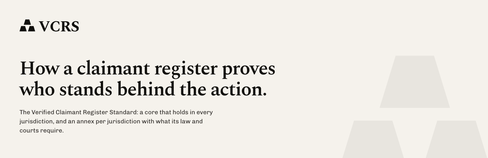

# VCRS

The Verified Claimant Register Standard: how a claimant register shows who stands behind a collective action.

Drafted by [Steddle](https://steddle.com). Draft for consultation. Not legal advice. Read it at [vcrs.org](https://vcrs.org), where every section of the core has an address of its own.

## What it is

A court asks the party that brings a collective action who supports it, and later who gets paid. VCRS sets how a register answers: every record graded by fixed rules, every sign-up flow and document traceable, coverage measured against a stated class size at a stated date, and an independent auditor who checks the count without trusting the operator. A jurisdiction-neutral core, and one annex per jurisdiction with what its law and courts require and what the standard asks beyond them, each item cited.

## What it asks

Every record gets a grade, set by fixed rules from the facts on it:

| Grade | A record is this grade when |
|---|---|
| D, not counted | Withdrawn, a duplicate, outside the class, anonymous, not told apart from a namesake, unconfirmed contact, joined through a flow that didn't say what the claim is, or without an opt-in made in time where the annex requires one |
| C, identified | A distinct, named person who confirmed a contact channel and joined through an informing flow |
| B, evidenced | C, and a document or an outside source places them in the class |
| A, corroborated | B, checked against an outside source, with identity verified through eIDAS or a scheme the annex names |

The register as a whole claims one level, which sets what it keeps and how the auditor checks it: **Registered** (grade C or better counted, sample tracing by the auditor), **Identified** (grade C or better counted and grade B reported, full recomputation, regenerated before each hearing) or **Verified** (grade B or better counted and grade A reported, the reproduction test on the live system). [The core](core.md) holds the rules.

## Apply it

1. **Pick the annex and the level.** The annex for the court's country; the level its section 7 recommends for your action.
2. **Define the class and its size.** The board approves a versioned class definition. State the denominator with its source, method and date.
3. **Make the sign-up flow inform.** Every version states the representative, the defendant, the claim and the period, and is captured when it goes live.
4. **Grade every record.** Export the facts ([`templates/records.csv`](templates/records.csv) for a spreadsheet, [`schema/export.schema.json`](schema/export.schema.json) for a system) and grade each record by section 4 of the core. The [test vectors](vectors) hold the grade each record must get.
5. **Fix the snapshot, audit, publish.** Anchor the snapshot's manifest (core 5.4), have the board's auditor check it, and publish the [conformance statement](templates/conformance-statement.md), filled in as [the example](templates/conformance-statement-example.md) shows.

The [self-assessment](checklist/self-assessment.md) is the same list as questions for the board.

## Contents

- [`core.md`](core.md): the core, the same in every jurisdiction
- [`annexes/`](annexes): one annex per jurisdiction, as markdown and as JSON, and the [template](annexes/_template.md) a new one follows
- [`schema/`](schema): the facts export, one record, and the conformance statement, in JSON Schema 2020-12
- [`vectors/`](vectors): records with the grade they must get, its reasons and the record's digest; any implementation in any language is checked against them
- [`checklist/`](checklist), [`templates/`](templates): for a board applying it by hand
- The example register, fictional, its timestamp included: its records ([`records.csv`](templates/records.csv)) and facts ([`register.json`](templates/register.json)), the same as one JSON export ([`export.json`](templates/export.json)), its manifest ([`manifest.json`](templates/manifest.json)), an inclusion proof that holds ([`proof.json`](templates/proof.json)) and one altered that does not ([`proof-altered.json`](templates/proof-altered.json)), a draft statement ([`statement-draft.json`](templates/statement-draft.json)), [its conformance statement](templates/conformance-statement-example.md), and every outcome a check must give ([`expected.json`](templates/expected.json))

## Jurisdictions

| | Regime | Annex |
|---|---|---|
| Austria | Verbandsklage auf Abhilfe, §§ 623 to 635 ZPO | [Annex AT](annexes/at.md) |
| Belgium | Action en réparation collective, Livre XVII CDE | [Annex BE](annexes/be.md) |
| Czech Republic | Hromadné řízení, zákon č. 179/2024 Sb. | [Annex CZ](annexes/cz.md) |
| Finland | Ryhmäkanne, ryhmäkannelaki 444/2007 | [Annex FI](annexes/fi.md) |
| Germany | Verbandsklage under the VDuG | [Annex DE](annexes/de.md) |
| Ireland | Representative action, Act No. 22 of 2023 | [Annex IE](annexes/ie.md) |
| Italy | Azione di classe and azione rappresentativa | [Annex IT](annexes/it.md) |
| Netherlands | WAMCA, art. 3:305a BW | [Annex NL](annexes/nl.md) |
| Poland | Postępowanie grupowe, ustawa z dnia 17 grudnia 2009 r. | [Annex PL](annexes/pl.md) |
| Portugal | Ação popular, DL 114-A/2023 | [Annex PT](annexes/pt.md) |

The core's residence rule (4.6) follows the Representative Actions Directive, so it holds in every member state.

## Citing

'VCRS 0.1.0-beta.5, core and Annex NL, <https://vcrs.org/v/0.1.0-beta.5>'. A released version stays unchanged at its own address, as core section 13 sets out. [The governance](GOVERNANCE.md) says how versions are released and how to comment.

## Changelog

See [the changelog](CHANGELOG.md).

## Credits

- Holly Thackwray, Steddle
- Mischa Sigtermans, Steddle

## License

CC BY 4.0. See [the licence](LICENSE.txt).
